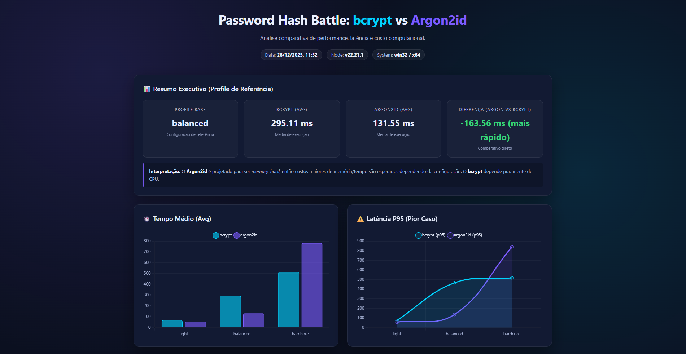

# Password Hash Battle — bcrypt vs Argon2id 🥊🔐


Projeto prático de benchmark para comparar **bcrypt** e **Argon2id** com foco em **performance**, **latência (p95)** e **custo computacional**, culminando na geração de um **relatório HTML5 interativo** com gráficos e explicações.

> **TL;DR**
> O **bcrypt** ainda é sólido, mas o **Argon2id** é a escolha moderna. Por ser *memory-hard*, ele oferece resistência superior a ataques paralelos via GPU/ASIC, permitindo ajustar o custo de memória independentemente do tempo de CPU.

---

## 🖼️ Preview do Relatório

O sistema gera um dashboard HTML5 responsivo com gráficos (Chart.js) comparando os algoritmos lado a lado.


*(Exemplo do relatório gerado em `results/report.html`)*

---

## 🎯 Objetivo do Projeto

Este repositório foi criado para demonstrar, de forma **prática e visual**, as diferenças reais entre os algoritmos:

- ⏱️ **Tempo de Execução:** Quanto tempo cada algoritmo leva para gerar hashes.
- 📉 **Latência (P95):** Comportamento em cenários de "quase pior caso".
- 🛡️ **Custo de Ataque:** Por que Argon2id torna o ataque financeiramente inviável.
- 🎛️ **Tunagem:** Como os parâmetros (`cost` vs `memoryCost`) influenciam a UX e a Segurança.

---

## 🧠 Teoria: Por que Argon2id?

O **Argon2id** (vencedor da *Password Hashing Competition*) foi projetado para a era moderna.

### 1. Memory-Hard (O Diferencial)
O Argon2id força o consumo de memória RAM durante o hash.
Isso torna ataques via **GPU e ASIC extremamente caros**, pois memória é um recurso escasso e caro em hardware dedicado a ataques, diferentemente de ciclos de CPU.

### 2. Parâmetros Granulares
Diferente do bcrypt (que só tem o `cost`), no Argon2id você controla:
- **`memoryCost`**: Quantidade de memória RAM alocada.
- **`timeCost`**: Número de passadas (iterações).
- **`parallelism`**: Threads simultâneas.

### 3. À Prova de Futuro
Conforme o hardware evolui, você não precisa trocar o algoritmo. Basta ajustar os parâmetros para manter o custo do ataque alto, sem necessariamente penalizar o tempo de login do usuário legítimo.

---

## ⚙️ Pré-requisitos

- **Node.js**: v18 ou superior (Recomendado v20+)
- **NPM**: Gerenciador de pacotes padrão

---

## 📦 Instalação

1. Clone o repositório:
   ```bash
   git clone [https://github.com/seu-usuario/password-hash-battle.git](https://github.com/seu-usuario/password-hash-battle.git)
   cd password-hash-battle
   ```

2. Instale as dependências:
   ```bash
   npm install
   ```

---

## 🚀 Como Usar

### 1️⃣ Executar Benchmark
Roda os testes de hash e coleta métricas de tempo.

**Execução padrão (Profile Balanced):**
```bash
npm run bench
```

**Execução completa (Todos os Profiles):**
```bash
npm run bench -- --profile=all --runs=6
```
> *Profiles disponíveis:* `light`, `balanced`, `hardcore`, `all`.

### 2️⃣ Gerar Relatório HTML (Recomendado)
Processa o JSON do benchmark e gera o dashboard visual.

**Rodar benchmark + gerar relatório:**
```bash
npm run report
```

**Apenas gerar relatório (se já tiver o JSON):**
```bash
npm run report:no-bench
```

📂 **Saída:**
- Dados: `results/benchmark.json`
- Visual: `results/report.html` (Abra este arquivo no navegador).

### 3️⃣ Simulação de Ataque (Didático)
Simula um ataque de dicionário simples para visualizar o custo de verificação.

```bash
npm run attack -- --profile=hardcore
```

---

## 📊 Como Interpretar os Resultados

| Métrica | Significado | Importância |
| :--- | :--- | :--- |
| **avg (Média)** | Tempo médio para gerar 1 hash. | Impacta diretamente a **UX** (login não pode demorar 5 segundos). |
| **p95** | Latência de 95% das requisições. | Mostra a estabilidade. 95% dos logins foram mais rápidos que esse valor. |
| **Params** | Configurações usadas. | Define o **Custo de Segurança**. |

> **Regra de Ouro:** O hash deve ser lento o suficiente para desencorajar o atacante, mas rápido o suficiente (ex: < 500ms) para não irritar o usuário.

---

## 🧩 Profiles Explicados

Os profiles em `src/profiles.js` facilitam a comparação:

- **🟢 Light:** Rápido, baixo custo de memória. Ideal para testes locais ou hardware limitado.
- **🔵 Balanced:** Ponto de partida recomendado para produção (equilibra segurança/UX).
- **🔴 Hardcore:** Alto custo de memória/tempo. Demonstra o poder do Argon2id (ótimo para servidores robustos).

---

## 📁 Estrutura do Projeto

```pgsql
password-hash-battle/
├── src/
│   ├── benchmark.js        # Lógica de execução dos testes
│   ├── attack-simulation.js # Script de força bruta didático
│   ├── report.js           # Gerador do HTML + Chart.js
│   ├── profiles.js         # Configurações dos algoritmos
│   └── cli.js              # Entry point
├── results/
│   ├── benchmark.json      # Dados brutos
│   └── report.html         # Dashboard final
├── assets/
│   └── report.png          # Imagem para o README
├── package.json
└── README.md
```

---

## ❓ FAQ

**1. O bcrypt é inseguro?**
Não. Ele ainda é criptograficamente seguro. Porém, em 2024+, ele oferece menos resistência "custo-benefício" contra atacantes com hardware especializado do que o Argon2id.

**2. Argon2id é mais lento. Isso é ruim?**
Depende. Segurança *é* lentidão controlada. O objetivo é ser lento para o atacante (que testa bilhões de senhas) e aceitável para o usuário (que digita uma vez).

**3. Qual configuração devo usar em produção?**
Nunca copie e cole cegamente. Teste no seu hardware de produção usando este projeto para garantir que o tempo de resposta fique abaixo do seu limite de UX (ex: 300ms).

---

## 🛣️ Roadmap

- [x] Benchmark comparativo (avg/p95)
- [x] Relatório HTML5 com Chart.js
- [ ] Exportação para CSV
- [ ] Gerar screenshot automático do relatório (Puppeteer/Playwright)
- [ ] GitHub Actions para rodar testes automaticamente

---

## 📄 Licença

Este projeto está sob a licença MIT. Sinta-se livre para usar, estudar e modificar.